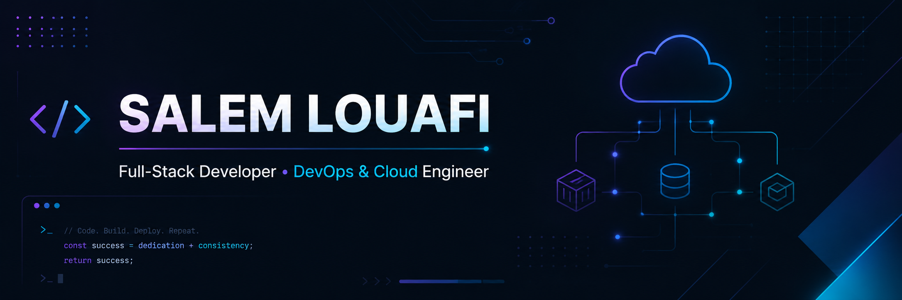

<div align="center">



# Salem Louafi (Al Wafi Salem Abdeljawad)

### Full-Stack Developer • DevOps & Cloud Enthusiast • Software Engineer

<p>
  
  
</p>

<p>
  <a href="https://www.linkedin.com/in/salem-louafi-off">
    
  </a>
  <a href="https://www.instagram.com/salem_louafi">
    
  </a>
  <a href="https://github.com/SalemDevLouy">
    
  </a>
</p>

</div>

---

## 👋 About Me

I'm a **Full-Stack Developer & DevOps Engineer** with a Master's degree in *Software Engineering and Intelligent Systems* from **University of Constantine 2**, plus a Bachelor's in *Web & Mobile Application Development*.

I build **real-world applications, not tutorial graveyards** — from ed-tech platforms to internal enterprise tools. My core stack is **JavaScript / Next.js**, and over the last two years I've been going deep into **DevOps, Linux, Docker, and AWS**, learning how the things I build actually run in production.

I care about:
- 🏗️ Clean architecture over hacks
- ⚙️ Understanding how systems really run — not just how to ship code
- 🚀 Shipping things that work in the real world, under real constraints

Still learning. Still breaking things. Still improving.

---

## 💼 Experience Highlights

```text
2026 – Present   Software Developer / Engineer  @ Evolvit.tech
2024 – 2026      Freelance Frontend Developer    — Next.js Specialist
2024             Software Dev Intern             @ Algérie Télécom (Garage Management App)
2023             Network Intern                  @ Algérie Télécom
2022             Business Structure Intern       @ Algérie Télécom
```

> Currently building software solutions in a team environment at **Evolvit.tech**, working across the full dev lifecycle from problem-solving to delivery.

---

## 🛠️ Tech Stack

<table>
<tr>
<td valign="top" width="50%">

**Frontend**
- JavaScript (ES6+), TypeScript
- React, Next.js
- HTML5, CSS3, Tailwind CSS

**Backend**
- Node.js, Express
- REST APIs, Auth flows

**Databases**
- MongoDB, MySQL, PostgreSQL
- Appwrite

</td>
<td valign="top" width="50%">

**DevOps & Cloud**
- Linux, Nginx
- Docker, Docker Compose
- AWS (EC2, S3, IAM)
- Git & GitHub / CI-CD

**Other**
- Java, PHP, Django (basics)
- Electron
- VS Code, Android Studio, Anaconda

</td>
</tr>
</table>

<p align="center">
  
</p>

---

## 🚀 Featured Projects

### 🎓 Tayssir-BAC
A Duolingo-style learning app for high school students preparing for the **BAC exam**, built for a startup client.
**Tech:** Next.js, React

### 📊 Daliloka
A Business Model Canvas (BMC) generator application.
**Tech:** Next.js, React

### 🛒 Multi-Service E-Commerce Sites
Multiple e-commerce websites built for clients across different service industries — product catalogs, cart/checkout flows, responsive design.
**Tech:** Next.js

### 📣 Marketing Landing Pages
Conversion-focused, fast-loading landing pages built for marketing agencies.
**Tech:** Next.js

### 🔹 DWAM
Landing page for the Web & Mobile Development major at the University of Djelfa.
**Tech:** TypeScript · ⭐ 2 stars

### 🔹 nextjs-14-auth-v5
Authentication implementation with Next.js 14 — auth flows, modern patterns.

### 🔹 linuxupskillchallenge
Hands-on Linux server administration practice — CLI & system fundamentals.

### 🔹 Artificial_Intelligence_Module
University module covering AI fundamentals.
**Tech:** Jupyter Notebook

### 🔹 grade_calculator
Simple Android app for academic grade calculation.
**Tech:** Java

---

## 📈 GitHub Stats

<p align="center">
  
  
</p>

<p align="center">
  
</p>

- Public repos: 52
- Focus: learning-by-building, not padding stars

---

## 🎯 Current Focus

- Deepening DevOps & Cloud skills (Docker, AWS, CI/CD)
- Sharpening JavaScript / Next.js architecture patterns
- Writing cleaner, more maintainable, production-grade code
- Moving from "student projects" to "production mindset"

---

## 📝 Notes

- No fake hype
- No "full-stack ninja" nonsense
- Progress over perfection

If you're here, feel free to explore the repos. Some are rough. That's the point.

<div align="center">

<sub>Thanks for stopping by 👋</sub>

</div>
